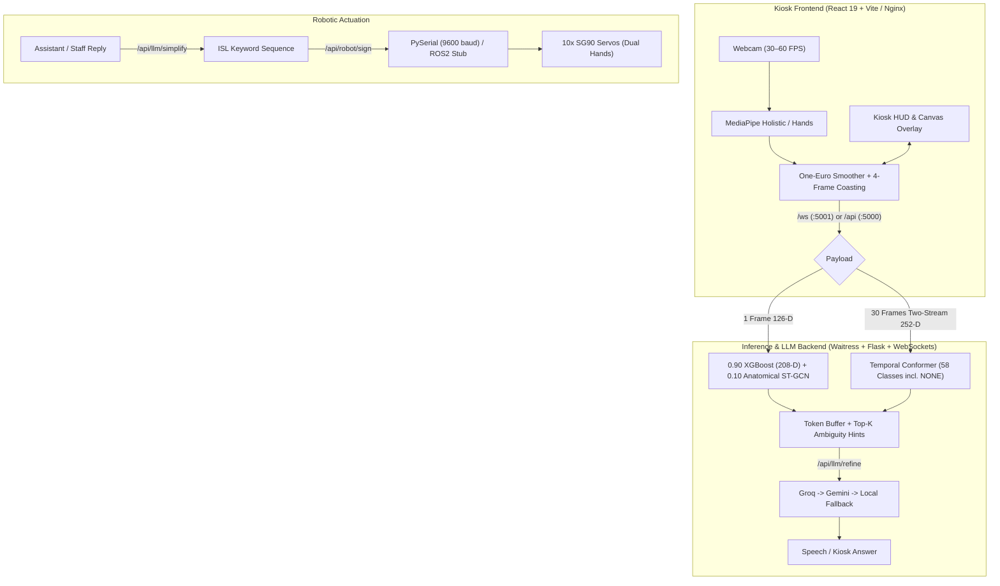

# SignBridge: Two-Way Indian Sign Language (ISL) Kiosk & Robotic Actuation System

[](https://react.dev/)
[](https://vitejs.dev/)
[](https://www.python.org/)
[](https://flask.palletsprojects.com/)
[](https://pytorch.org/)
[](https://xgboost.readthedocs.io/)
[](https://developers.google.com/mediapipe)
[](docker-compose.yml)
[](k8s/)
[](LICENSE)

> **A real-time, bidirectional Indian Sign Language (ISL) communication kiosk combining browser MediaPipe Holistic tracking, calibrated PyTorch + XGBoost recognition over WebSockets, Top-K LLM sentence refinement, and 10-servo physical robotic hand actuation.**

---

## Table of Contents

- [Project Overview](#project-overview)
- [Key Upgrades & Features](#key-upgrades--features)
- [Tech Stack](#tech-stack)
- [System Architecture](#system-architecture)
- [Project Structure](#project-structure)
- [Local Setup & Usage](#local-setup--usage)
- [Docker Deployment](#docker-deployment)
- [Kubernetes Deployment](#kubernetes-deployment)
- [Environment Variables](#environment-variables)
- [API & WebSocket Reference](#api--websocket-reference)
- [AI/ML Models & Verified Benchmarks](#aiml-models--verified-benchmarks)
- [Robotics & Hardware Actuation Layer](#robotics--hardware-actuation-layer)
- [Verification & Testing](#verification--testing)
- [Security & Hardening](#security--hardening)
- [License & Acknowledgements](#license--acknowledgements)

---

## Project Overview

Indian Sign Language (ISL) is predominantly **two-handed** and relies on both handshapes and body-relative signing space. **SignBridge** provides two synchronized communication paths on a split-screen kiosk:

1. **Perception Engine (Deaf → Hearing):** Tracks `42` 3D hand landmarks (`126` floats) plus `5` upper-body pose anchors (`15` floats: nose, shoulders, elbows) in the browser using MediaPipe Holistic (with automatic Hands fallback), smooths coordinates with a **One-Euro filter** (`LandmarkSmoother`) and `4`-frame occlusion coasting at `30–60 FPS`, and streams frames over WebSockets (`:5001`) or REST (`:5000`). A calibrated **XGBoost + Anatomical ST-GCN ensemble** classifies `26` letters (`A–Z`) and a **Two-Stream Temporal Conformer** classifies `58` dynamic words (including `NONE` idle/transition filtering). Uncertain signs attach `top_k` candidates so a multi-key **Groq → Gemini** pipeline reconstructs natural English sentences and speaks them via Web Speech TTS.
2. **Actuation Engine (Hearing → Deaf):** Converts spoken/typed responses into ISL keywords in parallel with UI rendering and commands dual 5-finger robotic hands (`10× SG90` micro-servos via Arduino USB serial @ `9600` baud, or an extensible `ROS2ActuatorStub`).

---

## Key Upgrades & Features

- **Stabilized Dual-Hand + Body Tracking ([useHandDetection.js](src/hooks/useHandDetection.js), [oneEuroFilter.js](src/utils/oneEuroFilter.js)):**
  - MediaPipe Holistic default pipeline (`pose_points` + `42` hand joints + `computeHandOverlap`) with transparent fallback to `@mediapipe/hands`.
  - Velocity-adaptive One-Euro smoothing with jump-reset threshold (`0.07`) and `4`-frame coasting (`COAST_MAX_FRAMES = 4`) across transient tracking drops.
  - `60 FPS` ideal / `30 FPS` minimum camera constraints ([useWebcam.js](src/hooks/useWebcam.js)) and `O(1)` `RingBuffer` frame windowing.
- **Calibrated Hybrid Alphabet Engine ([translator_model.py](backend/services/translator_model.py), [st_gcn.py](backend/models/st_gcn.py)):**
  - Blends **XGBoost (`geometric_invariants_208d`)** and **Anatomical ST-GCN (`pooling='anatomical'`)** using validation-tuned ensemble weights (`0.90 * XGB + 0.10 * ST-GCN, T=0.45`).
  - Returns `top_k` candidate hypotheses and `needs_crop` flags for ambiguity resolution, gated by confidence (`0.75`), margin (`0.10`), and per-class centroid distance validation.
- **Two-Stream Temporal Word Recognizer ([temporal_conformer.py](backend/models/temporal_conformer.py), [word_recognizer.py](backend/services/word_recognizer.py)):**
  - Separates clip-anchored body-space trajectories (`Stream A`) from wrist-centered finger handshapes (`Stream B`) into a `252`-D temporal tensor over `30` frames.
  - `58` word classes (including explicit `NONE` idle/transition rejection) via `TemporalConformerWordClassifier` (`Depthwise Conv1D` + 2-layer Transformer + Attention Pooling), with `RandomForest` `.pkl` fallback.
- **Top-K LLM Disambiguation & Parallel Actuation ([app.py](backend/app.py), [groq_manager.py](backend/services/groq_manager.py), [gemini_manager.py](backend/services/gemini_manager.py)):**
  - Passes ambiguous sign alternatives (`alternatives`) into `/api/llm/refine`.
  - Prioritizes fast Groq models (`llama-3.3-70b-versatile`, `llama-3.1-8b-instant`) with caller-enforced timeouts, dual-key rotation, automatic failover to Google Gemini (`google-genai` / `google.generativeai`), and offline keyword fallback.
  - Parallelizes `/api/llm/simplify` + `/api/robot/sign` when generating kiosk replies ([useISLTranslation.js](src/hooks/useISLTranslation.js)).

---

## Tech Stack

| Layer | Technology | Purpose |
| :--- | :--- | :--- |
| **Frontend** | React 19, Vite 8, Framer Motion, Lucide | Split-screen kiosk UI, HUD overlays, Web Speech synthesis |
| **Vision & Smoothing** | MediaPipe Holistic & Hands, One-Euro Filter | In-browser `42` hand + `5` upper-body landmarks (`30–60 FPS`) |
| **Transport & Server** | Flask 3.0, Waitress 3.0, `websockets` | REST API (`:5000`), live prediction WebSocket (`:5001`), rate limits |
| **ML / Deep Learning** | XGBoost, PyTorch, Scikit-Learn, NumPy | Calibrated Hybrid Letter Ensemble & Two-Stream Word Conformer |
| **LLM Providers** | Groq SDK, Google GenAI SDK | Gloss refinement, conversational Q&A, ISL simplification |
| **Storage & Hardware** | SQLite 3, PySerial, Arduino (C++), ROS2 Stub | Dialogue persistence (`/data/signbridge.db`) & `10`-servo control |
| **Containers & Orchestration** | Docker, Docker Compose, Nginx, Kubernetes | Multi-stage builds, reverse proxy, PVC storage, Ingress routing |

---

## System Architecture



See [ARCHITECTURE.md](ARCHITECTURE.md) for component boundaries and data contracts.

---

## Project Structure

```text
SignBridge/
├── Dockerfile.backend              # Python 3.11 slim image (Waitress :5000 + WebSockets :5001, non-root appuser)
├── Dockerfile.frontend             # Node 20 builder -> Nginx Alpine static server + proxy
├── docker-compose.yml              # Local multi-container stack + persistent sqlite_data:/data volume
├── nginx.conf                      # SPA fallback + /api/ (:5000) & /ws (:5001) WebSocket proxy
├── .dockerignore                   # Excludes datasets, venv, .env, local caches, *_backup model weights
├── k8s/
│   ├── configmap.yaml              # PORT=5000, HOST=0.0.0.0, WS_PORT=5001, WS_HOST=0.0.0.0
│   ├── secret.yaml                 # GROQ_API_KEY, GOOGLE_API_KEY, SIGNBRIDGE_API_KEY placeholders
│   ├── backend-deployment.yaml     # Backend Deployment (fsGroup: 1000) + 1Gi PVC + ClusterIP Service
│   ├── frontend-deployment.yaml    # Frontend Deployment (2 replicas) + LoadBalancer Service (:80)
│   └── ingress.yaml                # ingressClassName: nginx routing /, /api -> :5000, /ws -> :5001
├── backend/
│   ├── app.py                      # Flask REST API, rate limiting, Waitress WSGI & WS launcher
│   ├── requirements.txt            # Pinned/bounded backend dependencies
│   ├── train_unified.py            # Training pipeline (--letters-only, --stgcn-only, --words-only)
│   ├── benchmark_alphabet_models.py# Validation calibration + held-out test suite comparison
│   ├── database/schema.py          # SQLite schema & parameterized conversation/dataset queries
│   ├── models/
│   │   ├── st_gcn.py               # STGCNHandClassifier (anatomical/mean pooling) & legacy STGCN_BiLSTM
│   │   ├── temporal_conformer.py   # TemporalConformerWordClassifier (Two-Stream Conformer)
│   │   ├── isl_xgboost_model.pkl   # Active XGBoost alphabet model (geometric_invariants_208d)
│   │   ├── isl_stgcn_model.pt      # Active ST-GCN model (pooling=anatomical)
│   │   ├── isl_cnn_lstm_word_model.pt # Active 58-class Temporal Conformer word checkpoint
│   │   ├── isl_word_classifier.pkl # Compact Random Forest word backup
│   │   └── *_training_meta.json    # Measured training & held-out benchmark metadata
│   ├── services/
│   │   ├── feature_extractor.py    # 208-D invariants, palm-frame alignment, Two-Stream 252-D features
│   │   ├── translator_model.py     # Hybrid ensemble inference, Top-K output, CentroidValidator
│   │   ├── word_recognizer.py      # Conformer/BiLSTM word sequence recognizer + motion gate
│   │   ├── websocket_server.py     # Async WebSocket prediction server (port 5001)
│   │   ├── groq_manager.py         # Multi-key Groq LPU pool + health tracking
│   │   ├── gemini_manager.py       # Multi-key Gemini fallback manager
│   │   └── arduino_serial.py       # 10-servo Arduino serial driver + robot_actuator.py ROS2 stub
│   └── tests/                      # 10 Pytest suites (89 tests)
└── src/                            # React 19 UI, hooks, One-Euro filter, canvas overlay, & Node tests
```

---

## Local Setup & Usage

### Prerequisites
- **Node.js** `>= 18`, **Python** `>= 3.10` (`3.11`/`3.12` recommended)
- Optional hardware: **Arduino Mega/Uno** with `10× SG90` servos over USB serial

### 1. Install Dependencies
```bash
git clone https://github.com/Chintannn-c/Sign-Bridge-.git
cd Sign-Bridge-

# Backend virtual environment
python -m venv .venv
# Windows (PowerShell): .\.venv\Scripts\Activate.ps1
# macOS/Linux:          source .venv/bin/activate
pip install -r backend/requirements.txt

# Frontend dependencies
npm install
```

### 2. Configure & Run
```bash
# Terminal 1 — Backend (Waitress :5000 + WebSockets :5001)
cd backend
python app.py

# Terminal 2 — Frontend (Vite dev server :5173 with /api and /ws proxies)
npm run dev
```
Set `FLASK_DEBUG=true` for local reloader-disabled Flask debugging on `127.0.0.1:5000`.

### Kiosk Keyboard Shortcuts
| Key | Action |
| :---: | :--- |
| `Space` | Toggle Demo / Live mode |
| `F` | Toggle Fullscreen Camera HUD |
| `1` / `H` | Commit Human Turn |
| `2` / `R` | Trigger Robot Response + TTS |
| `C` | Clear Buffer & History |

---

## Docker Deployment

The repository provides a two-container production stack via [docker-compose.yml](docker-compose.yml):

- **[Dockerfile.backend](Dockerfile.backend):** `python:3.11-slim` with OpenCV/MediaPipe system libraries (`libgl1`, `libglib2.0-0`, `libsm6`, `libxext6`), non-root user `appuser` (`uid 1000`), pre-owned `/data` SQLite directory, health check on `http://localhost:5000/api/health`, Waitress WSGI on `:5000`, and automatic background WebSocket listener on `:5001` (`HOST=0.0.0.0`).
- **[Dockerfile.frontend](Dockerfile.frontend) & [nginx.conf](nginx.conf):** Multi-stage `node:20-alpine` Vite build served by `nginx:alpine` on port `80` (`5173:80` on host), gzip compression, security headers, SPA fallback, and reverse proxies from `/api/` → `backend:5000` and `/ws` → `backend:5001` (`86400s` WS timeout).
- **[.dockerignore](.dockerignore):** Keeps datasets, `.env` files, virtualenvs, logs, and `*_backup.pt` / `*_backup.pkl` weights out of build contexts.

```bash
# Optional: create backend/.env first (container boots safely even without backend/.env)
docker compose up --build -d
# Open http://localhost:5173
```

---

## Kubernetes Deployment

Production manifests live under [k8s/](k8s/):

| Manifest | Purpose | Key Details |
| :--- | :--- | :--- |
| [k8s/configmap.yaml](k8s/configmap.yaml) | Non-secret runtime config | `PORT=5000`, `HOST=0.0.0.0`, `WS_PORT=5001`, `WS_HOST=0.0.0.0`, `LOG_LEVEL=INFO` |
| [k8s/secret.yaml](k8s/secret.yaml) | API credentials template | Replace `GROQ_API_KEY`, `GOOGLE_API_KEY`, `SIGNBRIDGE_API_KEY` before applying |
| [k8s/backend-deployment.yaml](k8s/backend-deployment.yaml) | Backend Pod + PVC + Service | `1` replica (`DB_PATH=/data/signbridge.db`), `fsGroup: 1000` for non-root PVC write access, `1Gi` `ReadWriteOnce` PVC, `/api/health` liveness/readiness probes, `ClusterIP` on `:5000` & `:5001` |
| [k8s/frontend-deployment.yaml](k8s/frontend-deployment.yaml) | Frontend Pods + Service | `2` Nginx replicas, HTTP `/` probes, `LoadBalancer` Service on port `80` |
| [k8s/ingress.yaml](k8s/ingress.yaml) | Unified Nginx Ingress | Uses `ingressClassName: nginx`, routes `/` → `signbridge-frontend-service:80`, `/api` → `signbridge-backend-service:5000`, and `/ws` → `signbridge-backend-service:5001` with `3600s` WebSocket timeouts |

> **Routing Note:** Expose Kubernetes traffic through [k8s/ingress.yaml](k8s/ingress.yaml) so `/api` and `/ws` resolve directly to `signbridge-backend-service`. Accessing `signbridge-frontend-service` directly via its `LoadBalancer` bypasses Ingress and expects Compose's `backend` hostname in `nginx.conf`.

```bash
# 1. Build images (or push to your registry and update image tags)
docker build -f Dockerfile.backend -t signbridge-backend:latest .
docker build -f Dockerfile.frontend -t signbridge-frontend:latest .

# 2. Update k8s/secret.yaml with real keys, then apply
kubectl apply -f k8s/configmap.yaml
kubectl apply -f k8s/secret.yaml
kubectl apply -f k8s/backend-deployment.yaml
kubectl apply -f k8s/frontend-deployment.yaml
kubectl apply -f k8s/ingress.yaml
```

---

## Environment Variables

Configure `backend/.env` (or `k8s/secret.yaml` in Kubernetes):

```env
# Primary LLM Provider (Groq LPU — dual-key pool supported)
GROQ_API_KEY_1=gsk_your_primary_groq_key
GROQ_API_KEY_2=gsk_your_backup_groq_key

# Fallback LLM Provider (Google Gemini — dual-key pool + GOOGLE_API_KEY fallback)
GEMINI_API_KEY_1=AIzaSy_your_primary_gemini_key
GEMINI_API_KEY_2=AIzaSy_your_backup_gemini_key

# API Auth (enforced automatically on non-local requests when set)
SIGNBRIDGE_API_KEY=your_shared_secret

# Server / WebSocket / Database
HOST=127.0.0.1
PORT=5000
WS_HOST=127.0.0.1
WS_PORT=5001
CORS_ORIGINS=http://localhost:5173
```

If external API keys are absent or rate-limited, all LLM routes automatically degrade to deterministic local keyword responses (`get_smart_fallback_response`).

---

## API & WebSocket Reference

### WebSocket Channel (`ws://<host>:5001` / `/ws`)
Bidirectional JSON frames for low-latency live predictions:
- `{ "type": "letter", "landmarks": [126 floats], "body_anchors": ... }` → letter prediction, confidence, `top_k`, `needs_crop`
- `{ "type": "word", "frames": [[126 floats], ...], "body_anchors": ... }` → `30`-frame word prediction & `top_k`

### HTTP REST Endpoints (`:5000` / `/api`)
| Method | Endpoint | Purpose |
| :--- | :--- | :--- |
| `GET` | `/api/health` | Service status, active model modes, Groq/Gemini key health, Arduino status |
| `GET` | `/api/llm/status` | Live health state of Groq, Gemini, and local fallback tiers |
| `GET` | `/api/model/info` | Alphabet model metadata, tuned weights, and held-out metrics |
| `GET` | `/api/words/info` | Word recognizer metadata (`58` classes) and input contract |
| `POST` | `/api/model/reload` | Reload model checkpoints from disk (`X-API-Key` protected) |
| `POST` | `/api/translate` | Classify single-frame `126`-D hand landmarks into an ISL letter |
| `POST` | `/api/translate/batch` | Batch single-frame letter inference |
| `POST` | `/api/translate/word` | Classify `30×126` sequence frames into an ISL word (`58` classes incl. `NONE`) |
| `GET` | `/api/gesture/config` | Active frontend/backend confidence & state-machine thresholds |
| `POST` | `/api/llm/refine` | Refine raw glosses + `alternatives` (`top_k`) into natural English |
| `POST` | `/api/llm/simplify` | Extract uppercase ISL vocabulary sequence from spoken English |
| `POST` | `/api/llm/answer` | Generate direct conversational assistant reply (`KIOSK_CONTEXT` + history) |
| `GET` | `/api/history` | Fetch recent persisted turns from SQLite |
| `POST` | `/api/history/clear` | Clear persisted conversation history (`X-API-Key` protected) |
| `POST` | `/api/collect_data` | Save annotated landmark frames cleanly (`X-API-Key` protected) |
| `GET` | `/api/robot/status` | Serial connection & robotic servo status |
| `POST` | `/api/robot/connect` | Connect Arduino serial (`X-API-Key` protected) |
| `POST` | `/api/robot/disconnect` | Disconnect Arduino serial (`X-API-Key` protected) |
| `POST` | `/api/robot/sign` | Dispatch text glosses to dual robotic hands (`X-API-Key` protected) |
| `POST` | `/api/robot/sign-letter` | Sign a single A–Z / 0–9 glyph on hardware (`X-API-Key` protected) |

---

## AI/ML Models & Verified Benchmarks

All metrics below are measured directly on the repository's partitioned datasets (`backend/train_unified.py` & `backend/benchmark_alphabet_models.py`):

### 1. Alphabet Classification (`26` classes, `A–Z`)
- **Dataset Split:** `16,854` Train (`89,120` augmented for ST-GCN, `67,416` for XGBoost) · `3,488` Cross-Signer Validation · `4,902` Held-Out Test (`1,264` duplicates skipped).

| Model | Val Acc | Raw Test Acc | Benchmark Acc (`CONF=0.75, MARG=0.10`) | Benchmark Macro F1 | Abstain Rate | Median Latency |
| :--- | :---: | :---: | :---: | :---: | :---: | :---: |
| **XGBoost (`geometric_invariants_208d`)** | `69.61%` | **`87.43%`** (`0.8724` F1) | **`83.27%`** | `87.06%` | `9.7%` | `11.69 ms` |
| **ST-GCN (`pooling='anatomical'`)** | `66.60%` | `82.46%` (`0.8228` F1) | `75.07%` | `82.96%` | `21.3%` | `2.66 ms` |
| **Calibrated Hybrid (`0.90*XGB + 0.10*ST-GCN, T=0.45`)** | `62.44%` *(thresh.)* | — | **`83.03%`** | **`87.12%`** | `10.5%` | **`14.77 ms`** |

*(An experimental `palm_aligned_208d` XGBoost variant improved occlusion-heavy letters such as `X` and `E`, but scored lower overall at `86.09%` raw / `81.78%` hybrid gated accuracy; `geometric_invariants_208d` remains default while `--palm-aligned` is available via CLI).*

### 2. Dynamic Word Classification (`58` classes including `NONE`)
- **Architecture:** `TemporalConformerWordClassifier` (`Two-Stream 252-D` features: clip-anchored body-space trajectory + wrist-centered handshape → Depthwise Conv1D → 2-layer Transformer Encoder `d_model=128, nhead=4` → Attention Pool).
- **Measured Performance (`14,500` balanced train sequences, `1,348` validation sequences):**
  - **Train Accuracy:** `99.9%` (early stopping at epoch `29/35`)
  - **Validation Accuracy:** **`51.11%`** across `58` classes (`NONE` idle/transition class at `1.000` F1; unseen single-video signer shift on `10` classes currently accounts for the validation ceiling until more multi-signer clips are collected).
  - **Fallback (`isl_word_classifier.pkl`):** Random Forest sequence backup (`23.15%` val accuracy).

---

## Robotics & Hardware Actuation Layer

- **Microcontroller & Servos:** Arduino Mega/Uno controlling `10× TowerPro SG90` micro-servos (`5` fingers × `2` hands) at `9600` baud over USB serial ([arduino_serial.py](backend/services/arduino_serial.py)).
- **Protocol:** `10`-element servo angle vectors `[L_thumb..L_pinky, R_thumb..R_pinky]` calibrated to `[0°, 180°]`.
- **Middleware Adapter ([robot_actuator.py](backend/services/robot_actuator.py)):** Abstract `BaseRobotActuator` + `ROS2ActuatorStub` for topic-based industrial arm integration.

---

## Verification & Testing

| Check | Command | Result |
| :--- | :--- | :--- |
| **Frontend Lint** | `npm run lint` | **`0` errors** (`2` pre-existing `exhaustive-deps` warnings in `useGestureRecognition.js`) |
| **Frontend Tests** | `npm run test` | **`11/11` passed** (`handTrackingOverlay`, `oneEuroFilter`, `splash`) |
| **Backend Pytest** | `python -m pytest backend/tests` | **`89/89` passed** across `10` test modules (models, WS, LLM failover, state machine, schema) |
| **Alphabet Benchmark** | `python backend/benchmark_alphabet_models.py` | **`83.03%` acc / `87.12%` Macro F1 / `14.77 ms` latency** on `4,902` test samples |
| **Docker Compose** | `docker compose config --quiet` | Validated compose syntax (`backend` + `frontend` + `sqlite_data` volume) |

---

## Security & Hardening

- **API Authentication (`SIGNBRIDGE_API_KEY`):** Mutating/hardware endpoints (`/api/model/reload`, `/api/history/clear`, `/api/collect_data`, `/api/robot/*`) validate constant-time `X-API-Key` (`hmac.compare_digest`); non-local requests fail closed when unset.
- **Rate Limiting & Payload Caps:** `Flask-Limiter` guards `/api/translate*`, `/api/llm/*`, and `/api/robot/*`; `MAX_CONTENT_LENGTH` capped at `20 MB`.
- **Input & DB Safety:** `validate_landmark_array` rejects malformed shapes/`NaN`/`Inf` before PyTorch/XGBoost calls; all SQLite queries are parameterized.
- **Container Hardening:** Non-root `appuser` (`uid 1000`), Waitress production WSGI server, Werkzeug debug RCE guard on non-localhost hosts, explicit MediaPipe/canvas cleanup preventing WebAssembly memory leaks.

---

## License & Acknowledgements

Licensed under the **MIT License** — see [LICENSE](LICENSE).

- **Google MediaPipe** (`holistic` & `hands`) for browser skeletal tracking
- **RealSign ISL Dataset** for partitioned benchmark evaluation
- **Groq & Google GenAI** for low-latency LLM failover
